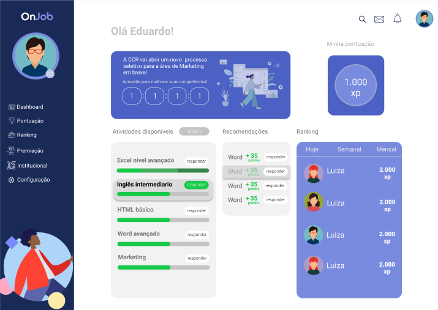

<p align="center">
  
</p>

<p align="center">
  
  
  <a href="https://rafaelfachinelli.com">
    
  </a>
  
</p>

<p align="center">
  <a href="#eye_speech_bubble-preview">Preview</a> •
  <a href="#information_source-about">About</a> •
  <a href="#memo-tasks">Tasks</a> •
  <a href="#arrow_forward-run">Run</a> •
  <a href="#hammer_and_wrench-technologies">Technologies</a> •
  <a href="#boy-author">Author</a> •
  <a href="#balance_scale-license">License</a>
</p>

---

## :eye_speech_bubble: Preview

<div align="center">

|Desktop|
|:---:|
|<kbd></kbd>|

</div>

---

## :information_source: About

🏆 A gamified platform for young people aged 16 to 20, made by team #113 at the CCR hackathon. Young people answer knowledge tests in several areas and earn awards (money or other prizes) according to their score and participation. Partner companies, with their own profile on the platform, see the results and can filter candidates in a complete database.

This repository has the young person's area: dashboard, scores, ranking and awards, with a sidebar and a notifications bar.

Built in 2021.

---

## :memo: Tasks

<div align="center">
<details>
<summary>Click to view</summary>

|State|Task|
|:---:|:---|
|:heavy_check_mark:|Sidebar and notifications bar|
|:heavy_check_mark:|Dashboard|
|:heavy_check_mark:|Score page|
|:heavy_check_mark:|Ranking|
|:heavy_check_mark:|Awards|
|:x:|Company area|
|:x:|Knowledge tests|

</details>
</div>

---

## :arrow_forward: Run

You need [Node.js](https://nodejs.org/) and [Yarn](https://yarnpkg.com/). In the project folder:

```bash
# Install dependencies
yarn

# Start the development server
yarn start
```

> The app opens at <http://localhost:3000>.

---

## :hammer_and_wrench: Technologies

<div align="center">

|Web|
|:---:|
|[React](https://react.dev/)|
|[TypeScript](https://www.typescriptlang.org/)|
|[styled-components](https://styled-components.com/)|
|[React Router](https://reactrouter.com/)|

</div>

---

## :boy: Author

<div align="center">

<a href="https://rafaelfachinelli.com">
  
  <br/>
  <sub><b>Rafael Fachinelli</b></sub>
</a>

Tech Lead and software engineer. Get in touch!

[](https://rafaelfachinelli.com)
[](https://www.linkedin.com/in/rafaelfachinelli/)
[](https://github.com/rafaelfachinelli)
[](mailto:rafael.l.a.fachinelli@gmail.com)

</div>

---

## :balance_scale: License

This project is under the [MIT license](./LICENSE).
